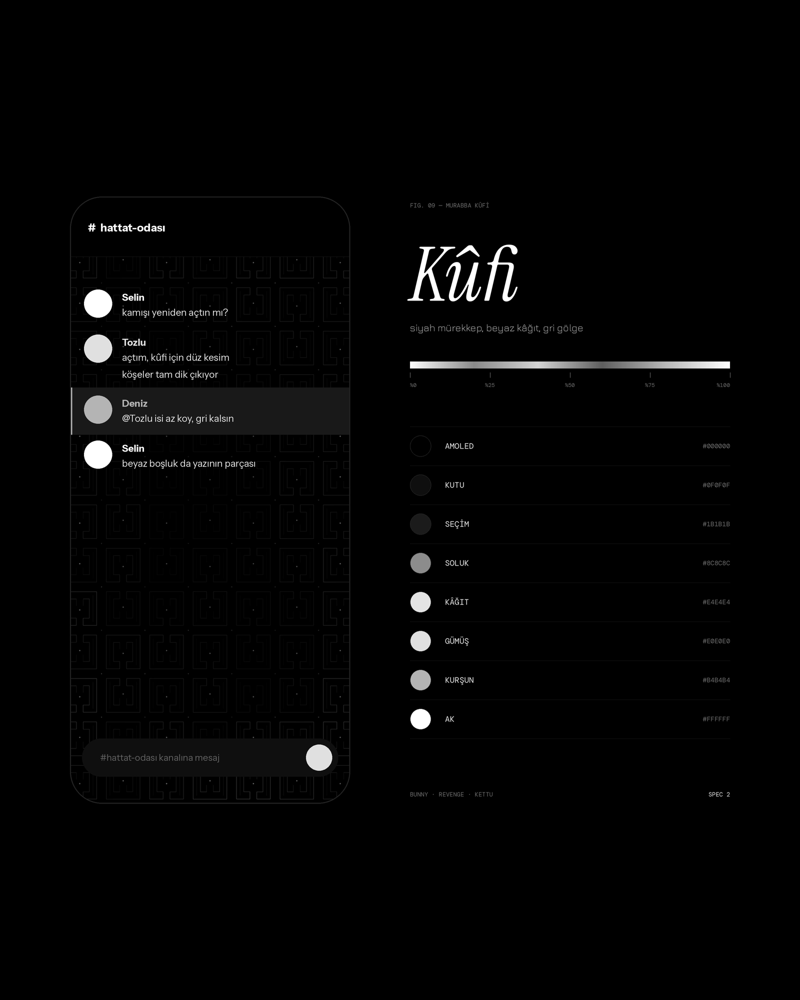

# Kûfi — Discord Teması

Bunny, Revenge ve Kettu için siyah, beyaz ve gri tonlarında, AMOLED siyahı bir tema. Murabba kûfi hattından esinlendi ve animasyonlu bir arka planı var.

## Kurulum

1. Discord'da **Ayarlar → Themes** bölümünü aç.
2. **+** simgesine dokun ve şu linki yapıştır:

   ```
   https://raw.githubusercontent.com/TozluMercek/gece-murekkebi/main/kufi/kufi.json
   ```
3. Temayı seç ve uygulamayı yeniden başlat.

Arka plan görseli temaya dahildir, ayrıca bir şey yüklemen gerekmez.

---

## Hakkında

Murabba kûfi hattından: is siyahı zemin, kâğıt beyazı ve kurşun grisi kare kıvrımlar. Hiç renk yok, AMOLED siyahı.



Arka plan animasyonludur (GIF): çizgilerin üzerinden geçen bir ışık süzmesi, dönen baklavalar ve nefes alan noktalar. İstemcin GIF oynatmazsa JSON'daki `background.url` sonundaki `kufi-arkaplan-v2.gif` kısmını `kufi-arkaplan.jpg` yap, aynı desenin durağan hâli gelir.

Tasarım felsefesi: [kufi/kufi-felsefe.md](kufi/kufi-felsefe.md)
