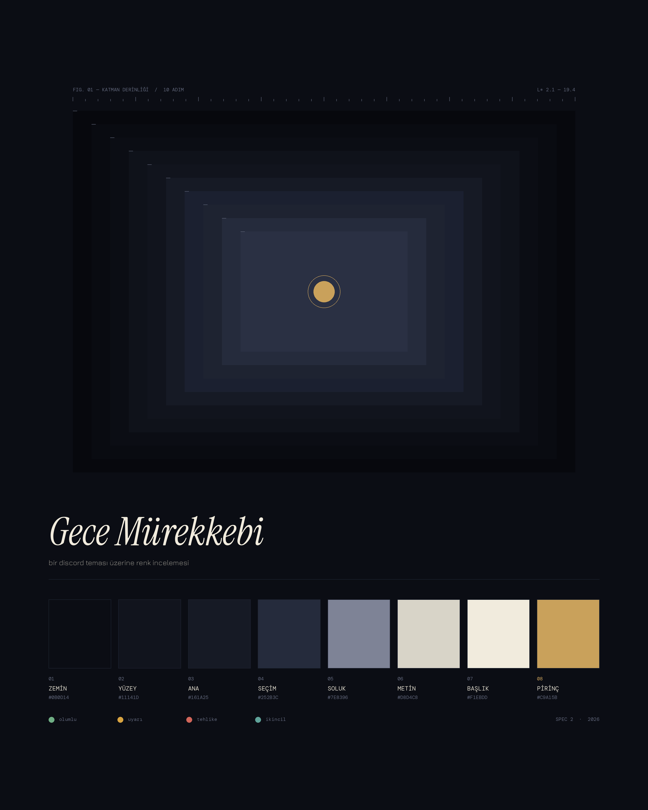

# Gece Mürekkebi

Katmanlı lacivert mürekkep tonları, parşömen renginde metin ve tek bir pirinç vurgu rengiyle bir Discord teması.



## Kurulum (Bunny / Revenge / Kettu)

1. Discord'da **Ayarlar → Themes** bölümünü aç.
2. **+** simgesine dokun ve şu linki yapıştır:

   ```
   https://raw.githubusercontent.com/TozluMercek/gece-murekkebi/main/gece-murekkebi.json
   ```
3. Temayı seç ve uygulamayı yeniden başlat.

## Palet

| Rol | Renk |
|---|---|
| Zemin | `#0B0D14` |
| Yüzey | `#11141D` |
| Ana arka plan | `#161A25` |
| Seçim | `#252B3C` |
| Soluk metin | `#7E8396` |
| Metin | `#D8D4C8` |
| Başlık | `#F1EBDD` |
| Pirinç vurgu | `#C9A15B` |

Tasarım felsefesi için: [gece-murekkebi-felsefe.md](gece-murekkebi-felsefe.md)
