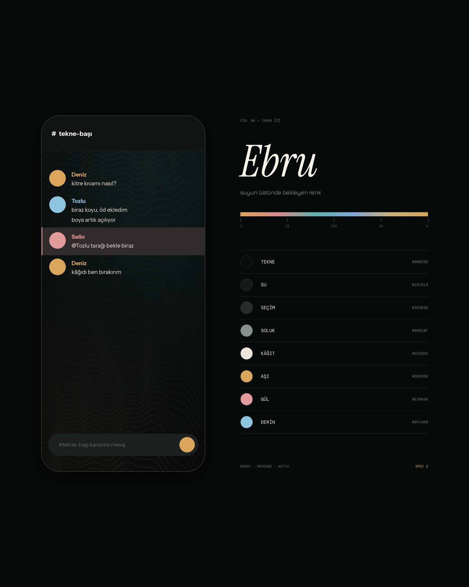
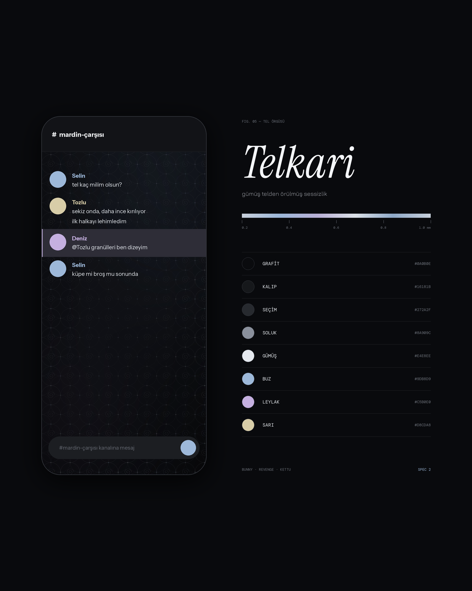
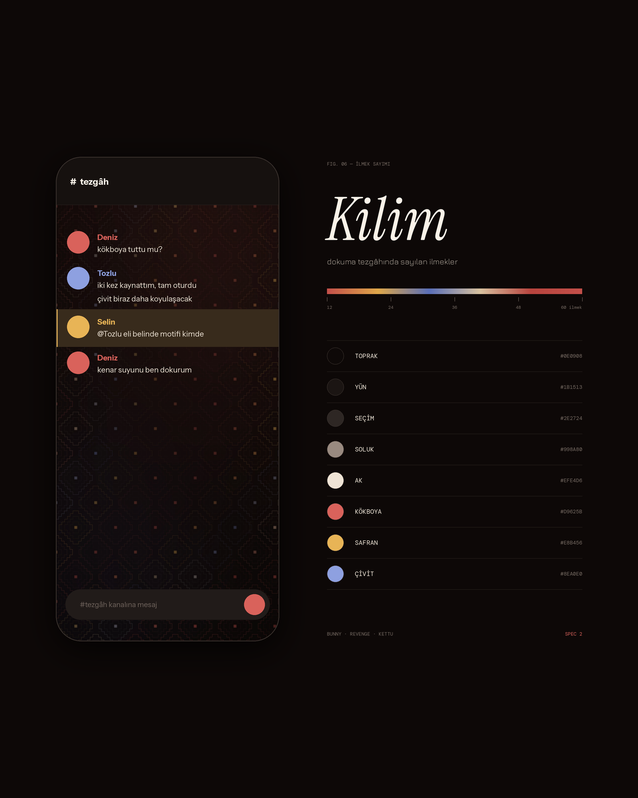
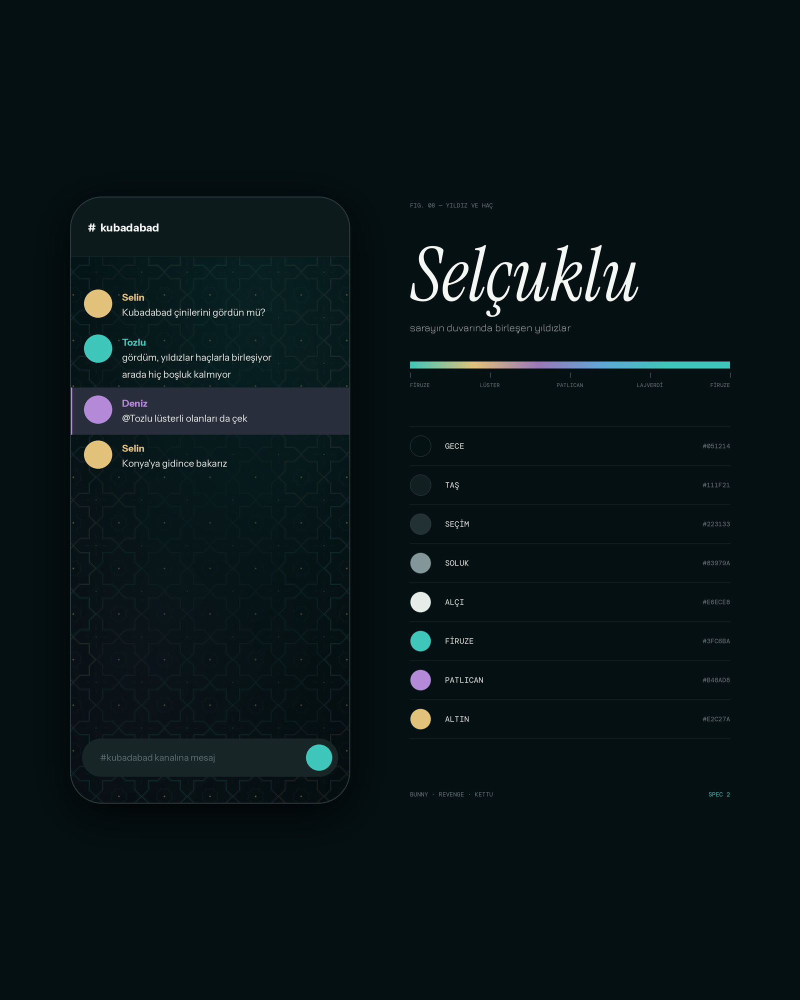
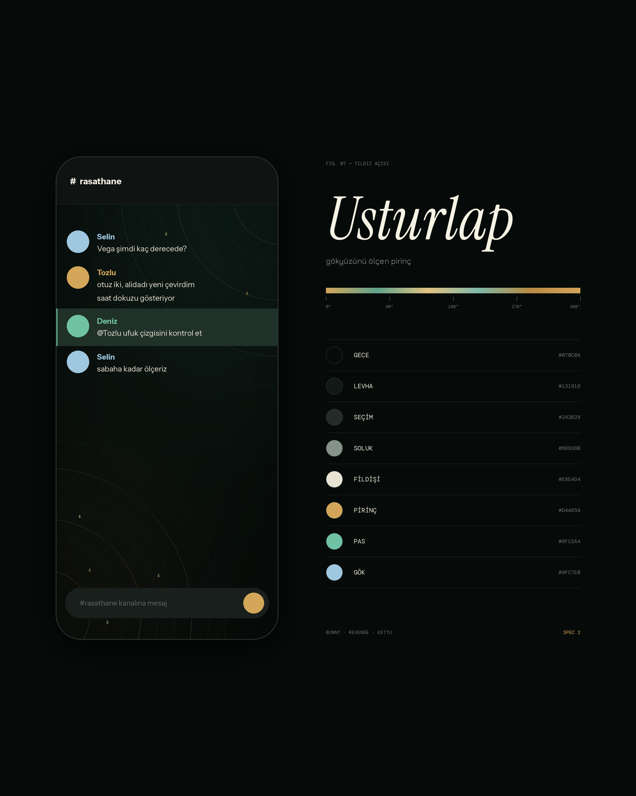

# Anadolu Zanaatları — Discord Temaları

Bunny, Revenge ve Kettu için altı tema. Her biri bir Anadolu zanaatından esinlendi ve kendine özel çizilmiş bir arka plan desenine sahip.

## Kurulum

1. Discord'da **Ayarlar → Themes** bölümünü aç.
2. **+** simgesine dokun ve aşağıdaki linklerden birini yapıştır.
3. Temayı seç ve uygulamayı yeniden başlat.

Arka plan görselleri temalara dahildir, ayrıca bir şey yüklemen gerekmez.

| Tema | Link |
|---|---|
| Sedef | `https://raw.githubusercontent.com/TozluMercek/gece-murekkebi/main/sedef/sedef.json` |
| Ebru | `https://raw.githubusercontent.com/TozluMercek/gece-murekkebi/main/ebru/ebru.json` |
| Telkari | `https://raw.githubusercontent.com/TozluMercek/gece-murekkebi/main/telkari/telkari.json` |
| Kilim | `https://raw.githubusercontent.com/TozluMercek/gece-murekkebi/main/kilim/kilim.json` |
| Selçuklu | `https://raw.githubusercontent.com/TozluMercek/gece-murekkebi/main/selcuklu/selcuklu.json` |
| Usturlap | `https://raw.githubusercontent.com/TozluMercek/gece-murekkebi/main/usturlap/usturlap.json` |

---

## Sedef

Abanoz lake zemin, sedef kakma girih deseni, firuze, leylak, gül ve altın arasında kayan inci vurgular.


```
https://raw.githubusercontent.com/TozluMercek/gece-murekkebi/main/sedef/sedef.json
```

Tasarım felsefesi: [sedef/sedef-felsefe.md](sedef/sedef-felsefe.md)

---

## Ebru

Koyu tekne suyu, tarakla çekilmiş aşı boyası, gül kurusu ve deniz mavisi damarlar.



```
https://raw.githubusercontent.com/TozluMercek/gece-murekkebi/main/ebru/ebru.json
```

Tasarım felsefesi: [ebru/ebru-felsefe.md](ebru/ebru-felsefe.md)

---

## Telkari

Grafit zemin, gümüş telden örülmüş halkalar, granül taneleri ve buz mavisi parıltı.



```
https://raw.githubusercontent.com/TozluMercek/gece-murekkebi/main/telkari/telkari.json
```

Tasarım felsefesi: [telkari/telkari-felsefe.md](telkari/telkari-felsefe.md)

---

## Kilim

Koyu yün zemin, kökboya kırmızısı, safran ve çivit basamaklı baklava motifleri.



```
https://raw.githubusercontent.com/TozluMercek/gece-murekkebi/main/kilim/kilim.json
```

Tasarım felsefesi: [kilim/kilim-felsefe.md](kilim/kilim-felsefe.md)

---

## Selçuklu

Kubadabad Sarayı'nın yıldız ve haç çinileri: firuze, patlıcan moru ve altın lüster çift bantlı geçmeler.



```
https://raw.githubusercontent.com/TozluMercek/gece-murekkebi/main/selcuklu/selcuklu.json
```

Tasarım felsefesi: [selcuklu/selcuklu-felsefe.md](selcuklu/selcuklu-felsefe.md)

---

## Usturlap

Gece yeşili zemin, pirinç derece halkaları ve bakır yeşili yıldız işaretçileri.



```
https://raw.githubusercontent.com/TozluMercek/gece-murekkebi/main/usturlap/usturlap.json
```

Tasarım felsefesi: [usturlap/usturlap-felsefe.md](usturlap/usturlap-felsefe.md)
